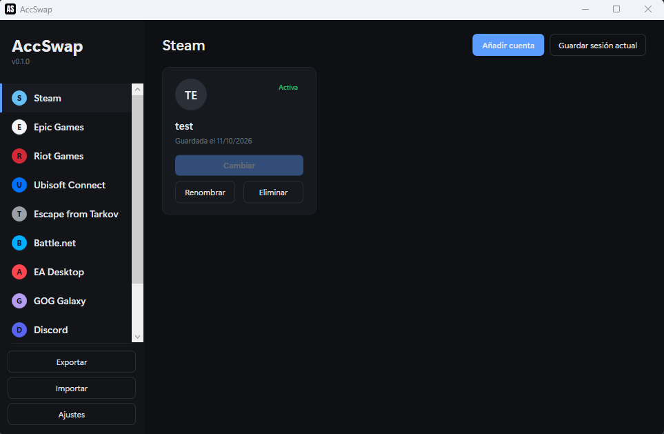

<div align="center">


# AccSwap

**Cambia de cuenta en Steam, Epic y otros launchers de juegos, rápido y seguro.**

[](https://github.com/fredericjasmin/AccSwap/releases/latest)
[](LICENSE)
[](https://dotnet.microsoft.com)
[](https://github.com/fredericjasmin/AccSwap/releases/latest)

[Español](README.es.md) · [English](README.md)

</div>

---



## ¿Qué es AccSwap?

AccSwap es un cambiador de cuentas para launchers de juegos en Windows, gratuito y de código abierto. Guarda la sesión iniciada de cada cuenta en tu máquina, así que cambiar de cuenta es un clic, sin volver a escribir contraseñas, sin códigos 2FA, sin códigos por email.

Todo queda en tu PC: AccSwap no tiene servidores, no requiere cuenta y no envía telemetría.

## Funciones

- Cambio de cuenta con un clic por plataforma, con la cuenta activa resaltada
- "Agregar cuenta" captura tu sesión actual; "Guardar sesión" guarda la cuenta con la que estás dentro
- Icono en la bandeja con la lista completa de cuentas: cambia sin abrir la ventana (atajo global `Ctrl+Alt+G`)
- Detección automática de launchers, incluidos los instalados en discos secundarios, con ruta manual por plataforma
- Actualización automática: AccSwap revisa GitHub Releases y se actualiza solo
- Exportar / importar cuentas y ajustes entre equipos (la importación es aditiva: nunca borra lo que ya tienes)
- Protección opcional con contraseña para los snapshots de cuentas (PBKDF2 + AES-GCM)
- Español e inglés, elegido según el idioma de tu sistema
- Un solo `.exe` portátil, sin instalador

## Plataformas soportadas

| Soporte | Plataformas |
|---|---|
| Dedicada (lógica de cambio completa) | Steam, Epic Games Store |
| Catálogo (snapshot de sesión + restauración) | Riot Games, Ubisoft Connect, Battle.net, EA Desktop, GOG Galaxy, Discord, Escape from Tarkov, Roblox |

Las plataformas del catálogo están verificadas por tests automatizados con carpetas simuladas. Si alguna falla en tu caso, su definición en `%APPDATA%\AccSwap\platforms.json` se puede corregir sin recompilar.

## Descarga

Descarga `AccSwap-vX.Y.Z.exe` desde la [última release](https://github.com/fredericjasmin/AccSwap/releases/latest) y ejecútalo. Es un ejecutable portátil: no requiere instalación y se actualiza solo desde GitHub.

> [!NOTE]
> El ejecutable aún no está firmado, así que Windows SmartScreen puede avisar la primera vez. Pulsa **Más información → Ejecutar de todas formas**. Ver la [hoja de ruta](#hoja-de-ruta).

## Cómo usarlo

1. Abre AccSwap y elige la pestaña de la plataforma (Steam, Epic, ...).
2. Inicia sesión en el launcher con la cuenta que quieres agregar.
3. En AccSwap, pulsa **Agregar cuenta**: la sesión queda guardada localmente.
4. Inicia sesión con otra cuenta en el launcher y repite.
5. Pulsa **Cambiar** en cualquier tarjeta para saltar a esa cuenta. AccSwap cierra el launcher, restaura la sesión y lo vuelve a abrir.

## Compilar desde el código

Requisitos: Windows 10/11, [SDK de .NET 10](https://dotnet.microsoft.com/download/dotnet), Visual Studio 2026 (opcional).

```bash
git clone https://github.com/fredericjasmin/AccSwap.git
cd AccSwap

dotnet build AccSwap.slnx               # compilar todo
dotnet test                          # correr los tests

dotnet publish AccSwap.App/AccSwap.App.csproj -c Release -r win-x64 --self-contained false -p:PublishSingleFile=true -o publish
```

## Hoja de ruta

- [ ] Firmar el ejecutable (para quitar el aviso de SmartScreen)
- [ ] Instalador (NSIS/WiX) además del portátil
- [ ] Más launchers: Origin, Rockstar, PS Remote Play, Magic Arena
- [ ] Atajos de escritorio por cuenta

## Contribuir

Issues y pull requests son bienvenidos. Para errores, incluye tu versión de Windows, la plataforma y qué esperabas frente a qué ocurrió.

## Licencia

[MIT](LICENSE) © Frederic Jasmin
